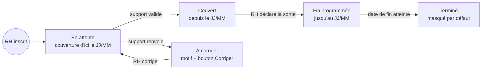

# SPEC · Prototype du portail RH Mutuelle Sabali

Deux parties : le PRD (le produit, sur une page, aussi en [PDF](PRD-portail-RH-Sabali.pdf)) et la spécification du prototype (ce qu'on construit maintenant). Le prototype couvre les parcours 1, 2 et 7 du PRD.

---

## Partie 1 · PRD

### Contexte et objectif

Sources : DRH de TransSahel, support, juriste, CEO, ticket de backlog. Aujourd'hui, les RH envoient leurs nouveaux salariés dans un Excel par mail ; le support les ressaisit en 3 à 5 jours ouvrés, avec des erreurs (nom mal orthographié, date de naissance manquante) qui font refuser la carte en pharmacie. 60 % des appels RH portent sur les inscriptions et sorties, 25 % sur les factures, 15 % sur les remboursements. Le ticket « Dashboard RH », vieux de deux ans (remboursements et médicaments par salarié), contredit la note juridique : à fermer.

**La V1 permet à une RH d'inscrire ses salariés, avec son Excel habituel ou un par un, de savoir qui est couvert, de déclarer les départs et de comprendre sa facture, sans appeler ni voir de donnée de santé.** Démo à TransSahel (300 salariés) dans 6 semaines ; cible proposée, à valider : −50 % d'appels « est-il couvert ? » à 3 mois.

### 1. Périmètre

- **Pour :** les RH des ~40 entreprises clientes, chacune limitée à la sienne, et le support de la mutuelle, qui valide les inscriptions. **Pas pour :** les salariés, qui suivent leurs demandes sur WhatsApp.
- **V1 :** P0 liste, inscription (formulaire et import Excel), validation par le support, sortie, aide « remboursements » ; P1 factures. Plus tard : ayants droit.
- **Jamais :** donnée médicale, remboursement ou consommation par salarié, classement de salariés, suspension décidée par la RH (le contrat la réserve à la mutuelle).

### 2. Règles de visibilité

Filtrage côté serveur, partout : écrans, API, exports, emails, messages d'erreur. Consommation agrégée (V2) : entreprise entière d'au moins 20 salariés, total seul.

| La RH voit | La RH ne voit jamais |
| --- | --- |
| Ses salariés : nom, date de naissance, matricule, téléphone | Un remboursement : existence, statut, montant, motif |
| Statut de couverture, dates, motif d'un blocage | Diagnostic, médicament, ordonnance, usage de la carte |
| Les factures de son entreprise | Classement de salariés, données d'une autre entreprise |

### 3. Parcours

**Statuts** : `EN_ATTENTE` (« couvert d'ici le JJ/MM ») → `COUVERT` → `FIN_PROGRAMMEE` → `TERMINE` ; `EN_ATTENTE` ⇄ `A_CORRIGER` (motif `NOM`, `DATE_NAISSANCE` ou `AUTRE`). Email à la RH à chaque changement.

1. **Liste** : en tête « 2 à corriger · 5 en attente », puis recherche et tableau, « à corriger » d'abord.
2. **Inscrire un salarié** : prénom(s) et nom tels que sur la pièce d'identité, dates de naissance et d'entrée requis ; erreurs sous le champ dès la saisie ; doublon d'une autre entreprise → « Contactez la mutuelle », sans la nommer.
3. **Importer un Excel, comme aujourd'hui** : colonnes reconnues par leur en-tête, mêmes contrôles ligne par ligne, aperçu « 12 prêtes · 2 à corriger · 1 déjà inscrit » avant tout envoi ; modèle à télécharger en secours.
4. **Valider (support)** : file des inscriptions en attente ; Valider, ou Renvoyer avec un motif.
5. **Sortir** (au lieu de « suspendre ») : la RH saisit une date de départ ; la mutuelle fixe la fin selon le contrat.
6. **Facture** (P1) : total du mois décomposé, chaque ligne reliée aux salariés concernés, sans donnée de soin.
7. **« Où en est mon remboursement ? »** : encart d'aide, jamais sur la ligne d'un salarié : « C'est confidentiel : écrivez au [numéro WhatsApp] où vous envoyez vos demandes. »

**États** : liste vide ; recherche sans résultat (« pas inscrit, donc pas couvert ») ; erreur de chargement, avec Réessayer.

### 4. Questions pour les décideurs

1. **CEO** : sa demande (consommation par salarié, top 10, suspension) est exclue par la note juridique. Ajoute-t-on dès la démo la consommation agrégée de TransSahel (légale à 300 salariés), au risque de retarder l'inscription en ligne ? *Par défaut :* non, V2 si les commerciaux la confirment.
2. **CEO et support** : quel délai d'activation promet-on aux RH ? *Par défaut :* le délai actuel (5 jours ouvrés), affiché en date, puis 1 jour ouvré dès que le support peut le tenir.
3. **CEO et support** : pour les remboursements, améliore-t-on WhatsApp plutôt que de créer un espace salarié ? *Par défaut :* oui, avec un message à chaque étape, motif de refus compris ; à revoir si ces appels ne baissent pas.

### 5. Hypothèses (supposé, non vérifié)

- La mutuelle charge les salariés déjà couverts et crée les comptes RH avant l'ouverture.
- Chaque entreprise a son format d'Excel : les en-têtes suffisent, le modèle sert de secours.
- Une inscription validée est aussitôt visible des pharmacies, même sans carte ; le chauffeur refusé n'était pas saisi, ou mal saisi.
- Les salariés interrogent leur RH faute de nouvelles sur WhatsApp, pas faute de connaître le numéro.
- La facture = cotisations par salarié + prorata ; une seule formule par entreprise.

---

## Partie 2 · Prototype

### Statuts de couverture

### Données fictives

- Génération déterministe (graine fixe) pour TransSahel Logistique : 300 salariés actifs et 12 sortis.
- Prénoms et noms sénégalais variés (Diop, Ndiaye, Fall, Sow, Ba, Sarr, Faye, Gueye, Diallo, Cissé, Mbaye, Seck, Thiam, Kane, Ndour…), matricules `TS-0001` et suivants.
- Statuts : 2 `A_CORRIGER` (un motif `NOM`, un motif `DATE_NAISSANCE`), 5 `EN_ATTENTE`, 3 `FIN_PROGRAMMEE`, le reste `COUVERT` ; les 12 sortis sont `TERMINE`.
- Une liste cachée « autres entreprises » contient au moins Moussa Diop, né le 12/03/1990, pour tester le doublon externe.
- La date du jour est la vraie date du navigateur ; les jours ouvrés excluent samedi et dimanche.

### Écran 1 · Liste des salariés (route `/`)

Ordre de lecture, du plus important au secondaire :

1. En-tête : « Mutuelle Sabali · Espace RH », le nom de l'entreprise et le bouton principal « Inscrire un salarié ».
2. Bandeau d'action : « 2 à corriger » (accent d'alerte) et « 5 en attente », cliquables pour filtrer la liste ; à côté, en discret, le nombre de salariés couverts. Quand rien n'est à corriger : « Tout est à jour ».
3. Recherche par nom ou matricule, filtrage instantané.
4. Tableau : Nom (prénom et NOM), Matricule, Statut (badge et ligne de date : « Couverture depuis le 03/02/2024 », « En attente · couverture d'ici le 05/11/2026 », « À corriger · nom différent de la pièce d'identité », « Fin programmée · couverture jusqu'au 30/11/2026 »), Action (« Corriger » sur les lignes à corriger). Tri : À corriger, puis En attente, puis ordre alphabétique. 50 lignes à la fois.
5. Secondaire, sous le tableau ou en colonne latérale : la bascule « Afficher les salariés sortis » et l'encart « Un salarié vous demande où en est son remboursement ? » avec la phrase du PRD, un numéro WhatsApp fictif (+221 77 000 00 00) et un bouton « Copier le message ».

« Corriger » ouvre le formulaire pré-rempli, avec le motif en tête ; le renvoi repasse le salarié en `EN_ATTENTE`. Sous 640 px de large, le tableau devient une liste de cartes.

### Écran 2 · Inscrire un salarié (route `/inscrire`)

- Lien « Retour à la liste », titre « Inscrire un salarié ».
- Champs dans cet ordre : Prénom(s)*, Nom*, avec l'aide « Tels qu'écrits sur la pièce d'identité : une lettre de différence et la carte peut être refusée en pharmacie. » ; Date de naissance* ; Date d'entrée dans l'entreprise* ; Téléphone WhatsApp (facultatif, « +221 suivi de 9 chiffres ») ; Matricule (facultatif).
- Encart « Après l'envoi », recalculé en direct : « Statut En attente · couverture d'ici le JJ/MM/AAAA. Vous recevrez un email dès que c'est validé. » La date est la plus tardive entre la date d'entrée et aujourd'hui + 5 jours ouvrés.
- Validation à la sortie du champ et à l'envoi. À l'envoi, résumé des erreurs en haut et focus sur le premier champ en erreur. Règles : champs requis ; date de naissance passée, âge entre 16 et 75 ans ; téléphone de 9 chiffres s'il est rempli.
- Doublon (même nom et même date de naissance, sans tenir compte des accents ni de la casse) : dans l'entreprise, « Ce salarié existe déjà. » avec un lien « Voir dans la liste » ; dans une autre entreprise, « Ce salarié est peut-être déjà inscrit ailleurs. Contactez la mutuelle au +221 77 000 00 00. », sans jamais nommer l'autre entreprise.
- Succès : retour à la liste, toast « Inscription envoyée pour Fatou Ndiaye · couverture d'ici le JJ/MM/AAAA », nouvelle ligne surlignée en tête du groupe En attente.
- Échec d'envoi simulé : bandeau en haut du formulaire « L'envoi a échoué. Vos informations sont conservées. » avec un bouton « Réessayer » ; rien n'est perdu.

### États à rendre visibles

- Liste vide : « Aucun salarié pour l'instant. Ajoutez votre premier salarié pour démarrer sa couverture. » et le bouton d'inscription.
- Recherche sans résultat : « Aucun salarié ne correspond à « Diop ». S'il n'apparaît pas, il n'est pas inscrit, donc pas couvert. » et le bouton « Inscrire un salarié ».
- Erreur de chargement : « Impossible de charger la liste. Vérifiez votre connexion. » et « Réessayer ».
- Chargement : squelette du tableau pendant la latence simulée.

### Barre de démo

Une fine bande sombre au-dessus du produit, clairement hors produit :

- « Prototype · données fictives ».
- Sélecteur de scénario : « TransSahel (300 salariés) », « Entreprise sans salarié », « Erreur de chargement ». Le scénario se reflète dans l'URL (`?scenario=vide`, `?scenario=erreur`) pour partager un état par lien.
- Bascule « Simuler un échec d'envoi ».
- Menu « À essayer » : inscrire quelqu'un sans date de naissance ; inscrire Moussa Diop, né le 12/03/1990 (doublon dans une autre entreprise) ; activer l'échec d'envoi puis inscrire.
- Bascule « Annotations » : des pastilles numérotées expliquent la hiérarchie. Sur la liste : 1 ce qui demande une action, 2 retrouver quelqu'un, 3 le détail, 4 l'aide secondaire. Sur le formulaire : 1 les champs qui causent les refus en pharmacie, 2 ce qui se passe après l'envoi.

### Qualité

- Accessibilité : labels liés aux champs, erreurs reliées par `aria-describedby`, navigation au clavier, contraste AA.
- Style sobre : police système ou Inter, gris neutres, une couleur d'accent ; couleurs de statut vert (couvert), ambre (à corriger), bleu (en attente), gris (sorti).

## Partie 3 · Hors périmètre du prototype

- Les parcours 3 à 6 du PRD : import Excel, validation par le support, sortie, factures.
- Authentification, base de données, envoi réel d'emails.
- Toute donnée de santé ou de remboursement, même fictive.

## Partie 4 · Vérification de bout en bout

Le travail est fini quand tout ceci passe, preuves à l'appui :

1. `npm run build` passe sans erreur.
2. Liste, via la barre de démo : TransSahel affiche « 2 à corriger · 5 en attente » en tête ; « Diop » filtre la liste ; une recherche sans résultat affiche son état ; les scénarios « vide » et « erreur » s'affichent, et « Réessayer » recharge.
3. Formulaire : un envoi sans date de naissance montre l'erreur sous le champ et y place le focus ; Moussa Diop, né le 12/03/1990, déclenche le doublon externe sans nommer d'entreprise ; l'échec d'envoi simulé garde la saisie ; une inscription réussie affiche le toast et la ligne surlignée en En attente, avec la bonne date « couverture d'ici ».
4. Le type `Salarie` et les données fictives ne contiennent aucun champ lié à la santé ou aux remboursements.
5. Trois captures dans `screenshots/` : la liste TransSahel, le formulaire avec erreurs, la liste vide.
